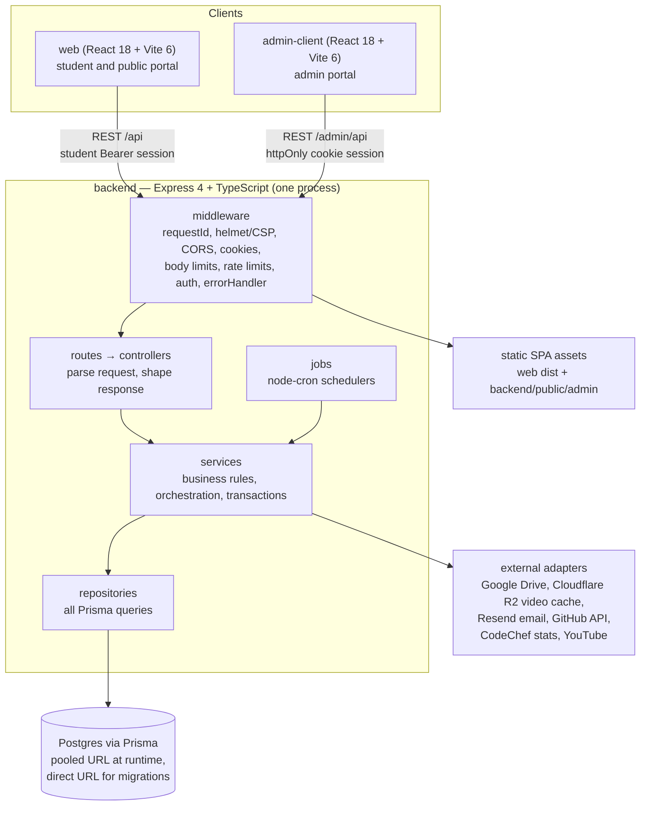

# System architecture

The portal is a modular backend with two independently built single-page
frontends. One Express process serves the API and the compiled frontend assets;
nothing in the repository talks to a separate application server.

## Request flow

1. `requestIdMiddleware` accepts an incoming request id or generates one. Every
   log line and every error response carries it.
2. Security middleware sets headers, resolves CORS, parses cookies and limits
   request bodies and request rates.
3. The route matches. Feature flags can prevent a router from being mounted at
   all (`FEATURE_LEARNINGHUB`, `FEATURE_CODECHEF`).
4. The controller parses the request and calls one service method. It does not
   query the database.
5. The service applies rules, opens transactions when several writes must move
   together, and calls other modules only through their public `index.ts`.
6. The repository performs Prisma queries with explicit field selection.
7. Failures are thrown as typed `AppError` subclasses and converted to one
   response envelope by the central error handler.

`GET /health` reports that the process is up; `GET /ready` checks the database
and critical dependencies. Both are deliberately cheap and unauthenticated.

## Two frontends, one backend

`web/` serves public pages (home, student directory, public profiles, public
events and videos) and the signed-in student app. Public routes must not pull
in authenticated application code. It identifies students with a token obtained
through SSO bootstrap and sends it as a Bearer header.

`admin-client/` is built into `backend/public/admin` and served under `/admin`.
It authenticates through `/admin/login`, `/admin/logout` and `/admin/me` using
httpOnly cookies.

Both apps use React Query for server state and share theme tokens from
`shared/tokens.mjs` / `shared/tokens.css`. Shared UI code may never import a
feature; see [architecture/layers.md](./architecture/layers.md).

## Scheduled and internal work

`backend/src/jobs/` holds node-cron schedulers for GitHub sync, CodeChef sync,
announcements, quiz reminders and retention cleanup. They call services and own
no queries. GitHub, CodeChef and video-cache internal routes are guarded by
`INTERNAL_SYNC_SECRET`; the CodeChef tick was unguarded until the cleanup and
now follows the same pattern. See [operations.md](./operations.md).

## Data boundaries

- Clients receive app-owned URLs such as `/api/public/media/<type>/<id>`;
  Google Drive file and folder ids are resolved on the server.
- Responses are explicit DTOs, never raw database rows.
- Student personal data stays out of logs, fixtures and documentation.
- External providers sit behind one adapter each, so a provider can be replaced
  without changing business rules.

## Frozen area

The portfolio feature (`web/src/features/portfolio/` and
`backend/src/modules/portfolio/`) is frozen. It is deliberately excluded from
general refactors and cleanup, even where it has known deviations from the
layer rules.
